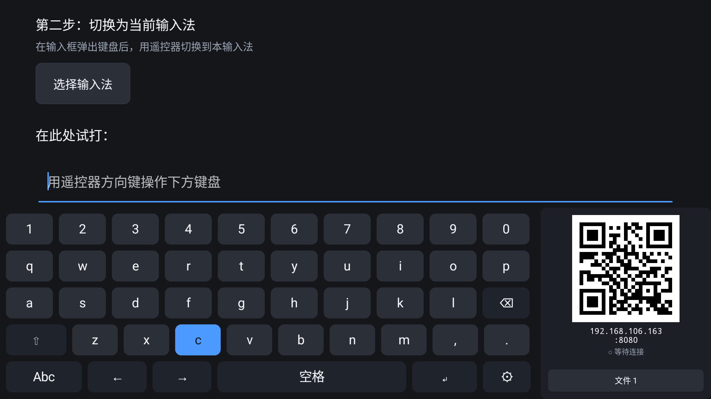

# TVBoard IME · Android TV 跨屏输入法

> 遥控器只有方向键和 OK，没有字符键。这个项目把「打字」这件事搬回手机上：
> 电视弹出键盘时，右侧常驻一个二维码，手机扫码即打，文字实时写进电视当前输入框。
> 屏幕软键盘保留为兜底，全程可用遥控器操作。

Android 5.0+ ・ Kotlin ・ 局域网直连 ・ 无账号无配对



<sub>截图为 v0.7 实机界面；面板底部的「文件」入口已在 v0.8 移除，跨屏通道现在只承载文字。</sub>

---

## 它解决什么问题

Android TV 的原生输入体验有三个结构性缺陷：

1. **输入设备缺失** —— 遥控器没有字符键，所有文字只能靠屏幕软键盘逐个「点选」，输一个英文单词平均要按 5–8 次方向键。
2. **第三方输入法不对 TV 适配** —— 主流中文输入法基本不处理 D-pad 焦点，界面按触摸尺寸设计，焦点高亮常常错乱甚至不可见。
3. **长文本几乎无法输入** —— Wi-Fi 密码、账号、URL、验证码这些 TV 上最高频的输入场景，恰好是遥控器最不擅长的。

所以本项目的定位不是「再做一个 TV 键盘」，而是 **以手机代打为主路径、屏幕软键盘为兜底的 TV 文字输入方案**。

## 核心特性

| 特性 | 说明 |
|---|---|
| **常驻二维码面板** | 二维码是 IME 根布局的兄弟节点，不随键盘页切换而重建 —— 任何输入状态下都可见、状态连续 |
| **扫码即用** | 手机扫码打开网页就能打，无需配对、无需装 App、无需输入任何验证信息 |
| **文字实时注入** | 手机输入 → TV 当前输入框，`commitText` 主线程执行；IME 已收起时文本进队列，下次弹出自动填入 |
| **D-pad 全功能导航** | 自研 `FocusNavigator` 几何寻址，不依赖 XML 静态邻接关系，适配动态生成的布局 |
| **中文拼音输入** | 全拼 + 简拼、候选栏、词频排序，本地 SQLite 词库 6.4 万词 / 3.42 MB，不联网 |
| **低配可用** | minSdk 21，实测目标包含 720p / 512MB 的 Android 5.0 盒子；无 Compose、无大体积 JSON 库 |
| **零远端依赖** | 全部逻辑在本机与局域网内完成，不请求任何第三方服务，无统计、无鉴权、无云端 |

## 怎么用

1. **安装** —— `adb install -r TVBoard-x.y.z.apk`，或拷到 U 盘用电视的文件管理器打开。
2. **启用（必须手动一次）** —— Android 不允许输入法自行启用，Gboard 也一样。打开应用 → 点「打开输入法设置」→ 找到「TVBoard IME」打开开关（原生 Android TV 上要先进「管理键盘 / Manage keyboards」这一层）。
3. **使用** —— 电视上任意输入框获得焦点 → 手机与电视连同一 Wi-Fi → 扫键盘右侧二维码 → 手机上打字、点发送。

完整步骤与常见问题见 [docs/安装说明.txt](docs/安装说明.txt)。

## 架构

```
┌──────────────────────── TV (IME 进程) ────────────────────────┐
│  TvImeService                                                  │
│   ├── RootLayout ──┬── KeyboardView ── InputEngine ── DictRepo │
│   │                └── QrPanel (常驻，不可聚焦)                 │
│   ├── FocusNavigator   ← D-pad 几何寻址 + 焦点记忆              │
│   ├── TextInjector     ← commitText / deleteSurroundingText    │
│   └── TransferHost     ← LocalHttpServer :8080                 │
└───────────────────────────────┬────────────────────────────────┘
                                │ 同一局域网
                    手机浏览器 ──┘  GET / · /api/state
                                    POST /api/text · /api/key
```

四个核心决策（详见[设计文档](docs/01-设计文档.md) §1.2）：

- **D1** 二维码挂根布局而非各键盘页 —— 保证实例唯一、不重复编码。
- **D2** 传输宿主内聚进 IME 进程 —— 二维码只在 IME 可见时可被扫到，独立前台服务换不到收益。
- **D3** 候选栏内嵌进键盘视图 —— `CandidatesView` 是独立窗口区域，TV 上 D-pad 焦点进不去。
- **D4** 焦点导航自研几何寻址 —— 布局是动态生成的，XML 的 `nextFocusXxx` 覆盖不到。

手机端是一个内嵌在 APK 里的单页（`app/src/main/assets/web/index.html`），无需安装、无需构建。

## 构建

### 环境要求

| 项 | 版本 |
|---|---|
| JDK | 17（AGP 8.5 要求） |
| Android SDK | Platform 34 + Build-Tools |
| Gradle | 8.7（仓库自带 wrapper，`./gradlew` 直接用） |
| Python | 3.9+，仅重新生成词库时需要 |

`local.properties` 写入 SDK 路径，或设置 `ANDROID_HOME` / `ANDROID_SDK_ROOT`：

```properties
sdk.dir=/path/to/Android/Sdk
```

### 命令行

```bash
# 调试包
./gradlew assembleDebug          # Windows: gradlew.bat assembleDebug

# 发布包（需先配好签名）
./gradlew assembleRelease
```

产物名由 Gradle 统一定义为 `<包名>_<构建类型><版本>_<yyMMddHHmm>.apk`，
Android Studio、命令行、CI 三条路产出一致：

```
app/build/outputs/apk/release/com.tvboard.ime_release1.0.0_2610311629.apk
```

### 用脚本（推荐日常）

`scripts/` 把构建、发布、改版本、生成词库四件事收敛起来，细节见 [scripts/README.md](scripts/README.md)。

```bash
bash scripts/build.sh              # 编译并归档到 dist/
bash scripts/build.sh release      # 签名构建
bash scripts/release.sh            # 签名 + 校验 + SHA-256
bash scripts/bump-version.sh 1.1.0 # 改版本号，versionCode 自动 +1
bash scripts/enable-ime.sh         # 在已连接设备上启用并选中本输入法
```

### 签名

发布签名材料**不入版本库**（`.gitignore` 已排除 `keystore.properties`、`release/`、`*.jks`）。
需要打正式包时：

```bash
cp keystore.properties.example keystore.properties
# 填入 storeFile / storePassword / keyAlias / keyPassword
```

文件缺失时 release 变体不签名，构建仍会成功 —— 由 `scripts/release.sh` 负责校验并给出指引。

## 词库

`app/src/main/assets/dict.db` 由 `scripts/build-dict.py` 生成，**不要手工编辑**：

```bash
python scripts/build-dict.py            # 约 20 秒，首次需联网下 8MB 数据源
python scripts/build-dict.py --refresh  # 强制重下数据源
```

数据源全部为 MIT 许可（pinyin-data、python-pinyin、jieba），因此产物可随闭源 APK 分发 ——
这也是刻意没有采用 rime-ice（GPL-3.0）的原因。脚本会同时写出 `dict.version`（`sha1-字节数`），
应用只在该戳变化时才把词库从 assets 拷到 `filesDir`。

词库随仓库提交（3.42 MB），这样 clone 下来即可构建出功能完整的 APK，无需先跑 Python。

## 目录结构

```
.
├── app/
│   └── src/main/
│       ├── java/com/tvboard/ime/
│       │   ├── ime/          键盘视图、焦点导航、输入引擎、IME 服务
│       │   ├── qr/           常驻二维码面板与编码器
│       │   ├── transfer/     局域网 HTTP 服务、文本队列、地址探测
│       │   ├── inject/       文本注入（含 InputConnection 降级路径）
│       │   ├── data/         词库访问
│       │   └── ui/           设置页
│       ├── assets/           手机端网页 + 拼音词库
│       └── res/              图标、主题、输入法声明
├── docs/                     设计文档、联调说明、安装说明、截图
├── scripts/                  构建 / 发布 / 版本 / 词库脚本
├── keystore.properties.example
└── settings.gradle.kts
```

## 文档

| 文档 | 内容 |
|---|---|
| [docs/01-设计文档.md](docs/01-设计文档.md) | 产品定位、功能设计、架构、核心实现、兼容性、风险 |
| [docs/02-模拟器跨屏联调.md](docs/02-模拟器跨屏联调.md) | AVD 无法与手机同网段的原因与端口转发方案 |
| [scripts/README.md](scripts/README.md) | 脚本职责、产物命名规则、词库与启用说明 |

## 设计边界

有意不做的事，避免预期错位：

- 不做手机端原生 App —— 手机侧是纯网页，扫码即用
- 不做跨公网传输 —— 仅限同一局域网
- 不做鉴权 / 加密 / 会话管理 —— 局域网内视为可信环境（见设计文档 §8）
- 不做文件投送 —— 跨屏通道只承载文字（v0.8 移除，理由见 §5.7）
- 不做语音输入、不做整句云联想
- 不支持 Android 4.4 及以下 —— IME 窗口行为与兼容成本不成比例

## 许可

代码以 [MIT](LICENSE) 许可发布。拼音词库数据来自 pinyin-data、python-pinyin、jieba（均为 MIT），
版权声明见 [app/src/main/assets/dict-NOTICE.txt](app/src/main/assets/dict-NOTICE.txt)。
