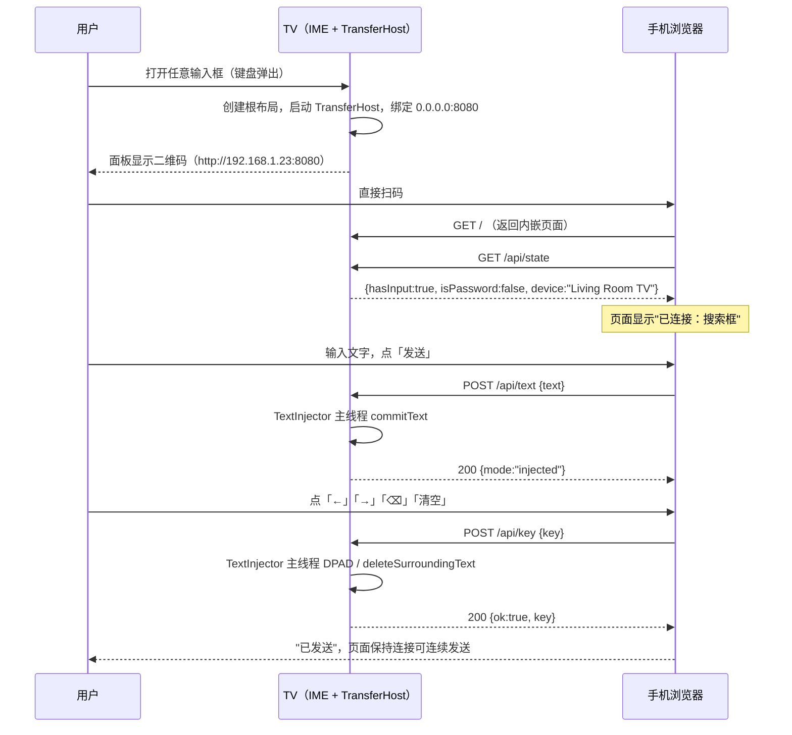
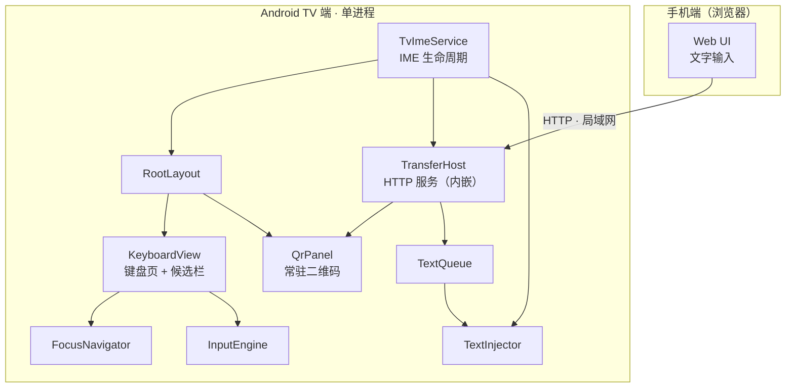
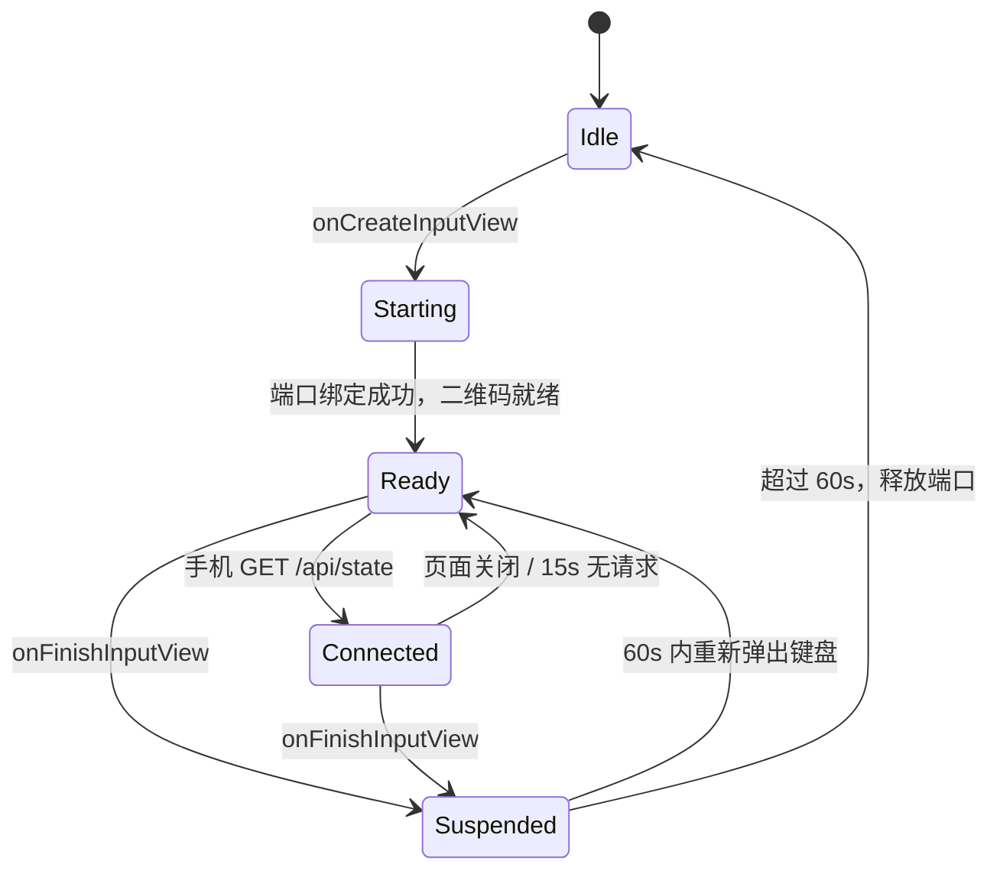

# Android TV 输入法 · 设计文档

| 项 | 内容 |
|---|---|
| 版本 | v0.8（移除文件投送，跨屏只承载文字） |
| 日期 | 2026-10-31 |
| 变更 | v0.8：移除文件投送整条链路（`/api/file`、`FileStore`、前台服务、`FileListActivity`、面板「文件」入口）；二维码边长回收 36dp<br>v0.7：实测确认 TV 输入法启用在第二层 `Manage keyboards`；设置页加三态状态检测与准确路径文案<br>v0.6：修正触摸/遥控器全面失效的根因（`isFocusableInTouchMode`）；补触摸点击与按键双通道；产物命名下沉到 Gradle 并含包名段<br>v0.5：自建拼音词库（6.3 万词 / 3.42 MB），重写 5.3 输入引擎；引入 `dict.version` 戳<br>v0.4：按 v0.3 完成首版实现，补充第 12 章实现状态；异步方案由协程改为 Handler/Executor<br>v0.3：minSdk 下调至 21（Android 5.0），新增兼容性设计章节<br>v0.2：二维码改为 IME 常驻面板；取消鉴权，限定局域网<br>v0.1：初稿 |
| 范围 | 产品定位、功能设计、系统架构、核心实现、技术选型与兼容性、里程碑、风险、实现状态 |

---

## 1. 产品定位与核心决策

### 1.1 问题陈述

Android TV 的原生输入体验存在结构性缺陷：

1. **输入设备缺失**。电视遥控器只有方向键、OK、返回、音量与少数几个功能键，没有字符键。所有文字必须通过屏幕软键盘逐个"点选"，输入一个英文单词平均需要 5–8 次方向键操作。
2. **第三方输入法生态缺失**。主流中文输入法基本不对 Android TV 做适配：不处理 D-pad 焦点、不响应遥控器按键、界面按触摸尺寸设计导致焦点高亮错乱甚至不可见。
3. **长文本与含符号内容几乎无法输入**。Wi-Fi 密码、账号、URL、验证码这类高频 TV 输入场景，恰好是遥控器最不擅长的场景。

因此本项目的定位不是"再做一个 TV 键盘"，而是：

> **以"手机代打"为主路径、屏幕软键盘为兜底的 TV 文字输入方案。**

v0.2 把扫码入口做成**常驻面板**：二维码不是一个需要主动进入的页面，而是键盘的一部分。用户路径从「打开键盘 → 找到扫码键 → 进入大屏 → 等待生成」压缩为「打开键盘 → 直接扫」。

> **v0.8 变更**：跨屏通道只承载文字。文件投送（上传 / 落盘 / 列表页 / 面板「文件」入口）整条链路移除，
> 理由见 [§5.7](#57-为什么不做文件投送)。

v0.3 把 **minSdk 下调到 21（Android 5.0）**。这是一个真实约束而非纸面参数：Android 5.0/5.1 的电视与盒子在存量市场占比可观，这类设备普遍是 720p 输出、512MB–1GB 内存、四核 A53 级 CPU。兼容性要求会反向影响存储策略、前台服务形态、图标资源与依赖选型，详见第 6 章。

### 1.2 四个核心架构决策

| 编号 | 决策 | 理由 |
|---|---|---|
| **D1** | **二维码作为 IME 根布局的常驻子视图**，与具体键盘页（英文/数字/中文/符号）无关 | 需求要求"任何输入状态下都可见"。若挂在各键盘页内部，切页即重建，会导致二维码反复编码、状态丢失；挂在根布局可保证实例唯一、状态连续。 |
| **D2** | **传输宿主内聚进 IME 进程** | 二维码只在 IME 可见时可被扫到，IME 隐藏时通道本就没有入口。独立前台服务带来的进程协调、存活管理成本换不到实际收益。改为 `TransferHost` 组件，由 `TvImeService` 生命周期驱动。 |
| **D3** | **候选栏内嵌在键盘视图内**，不使用 `onCreateCandidatesView` | `CandidatesView` 位于 IME 窗口的独立区域，TV 上无法用 D-pad 把焦点移入其中。内嵌后候选词与按键同属一棵焦点树，导航可控。 |
| **D4** | **焦点导航由自研 `FocusNavigator` 几何寻址驱动**，不依赖 `nextFocusXxx` XML 属性 | 键盘布局是动态生成（切页、切语言、候选栏显隐）的，XML 静态邻接关系无法覆盖；几何寻址对任意布局自适应，且可统一处理"焦点记忆"。 |

### 1.3 非目标

- 不做手机端原生 App（手机侧为纯 Web 页面，扫码即用）
- 不做跨公网传输（仅限同一局域网）
- 不做鉴权、加密、会话管理（局域网内视为可信环境，见第 9 章）
- **不支持 Android 4.4 及以下**：存量 4.4 盒子虽多，但其 IME 窗口行为、`VectorDrawable` 支持、运行时权限模型差异过大，兼容成本不成比例
- 不做语音输入、不做整句云联想

---

## 2. 运行环境与约束

### 2.1 平台矩阵

| 维度 | 目标 |
|---|---|
| **minSdk** | **21（Android 5.0 Lollipop）** |
| targetSdk / compileSdk | 34 |
| 系统版本 | Android 5.0 ～ Android 14 |
| 设备形态 | Android TV / Google TV / 国产智能盒子 / 智能电视内置系统 |
| 主要档位 | **低端**：720p + 512MB RAM + 四核 A53（多为 5.0/5.1）<br>**主流**：1080p + 1–2GB RAM（6.0–9.0）<br>**高端**：4K + 2GB+（10.0+） |
| 输入设备 | 蓝牙遥控器（D-pad）、红外遥控器、2.4G 空鼠（D-pad 模式） |
| 网络 | 与手机处于同一 Wi-Fi 或有线局域网 |

> 说明：TV 端**不需要 WebView**。手机侧页面运行在手机浏览器上，与电视系统版本无关，因此低版本 Android 的 WebView 老旧问题不影响本项目。

### 2.2 硬约束

1. **主交互无触摸屏**。所有可交互控件必须 `focusable=true` 且有明确 `state_focused` 视觉反馈（TV 上焦点高亮是唯一的位置指示）。
   但**触摸不能被当作"不存在"**：模拟器、触屏一体机、带触摸的商显，甚至开发时用鼠标点一下屏，
   都会让进程进入 touch mode。此时若控件 `isFocusableInTouchMode=false`，`requestFocus()`
   会静默失败并把整个焦点体系拖垮（详见 5.2 第 4 条）。触摸必须可用，且不得破坏遥控器链路。
2. **键事件无字符**。遥控器不产生 `KeyEvent.getUnicodeChar()`，字符必须由屏幕键盘逻辑产生。
3. **IME 窗口高度受限**。系统通常把输入法窗口限制在屏幕高度的 50% 以内，这直接决定了常驻二维码的物理尺寸——见 5.5。
4. **内存受限**。低端 5.0 设备常配 512MB RAM，应用需在 48MB 以内运行。这排除了 Compose、大体积 JSON 库与多份 Bitmap 缓存。
5. **CPU 受限**。二维码编码在 A53 上约 30–80ms，必须异步 + 缓存，不能放在 `onDraw` 或切页路径上。
6. **IME 启用入口隐蔽，且在 TV 上是两层结构**。系统输入法设置页（`KeyboardActivity`）只列 **已启用**的键盘；勾选入口藏在第二层 `Manage keyboards`（`AvailableVirtualKeyboardFragment`，取 `getInputMethodList()`，含未启用项）。用户在第一层看不到自己就极易误判为安装失败。
7. **`InputConnection` 行为不一致**。原生 `EditText`、`WebView`、Flutter/RN 自绘输入框对 `commitText` / `deleteSurroundingText` 的支持度不同，必须有降级路径。

---

## 3. 功能设计

### 3.1 功能地图

| 优先级 | 功能 | 说明 |
|---|---|---|
| **P0** | 常驻二维码面板 | 键盘右侧固定面板，任何输入状态下常显二维码 + IP:端口 + 连接状态 |
| **P0** | 英文 / 数字键盘 | QWERTY 布局、Shift、大小写锁定、数字行 |
| **P0** | D-pad 全功能导航 | 方向键移动焦点、OK 上屏、返回收起键盘 |
| **P0** | 基础编辑键 | 空格、退格（长按连续删除）、回车、光标左右移动 |
| **P0** | 扫码即连 | 手机扫码打开网页，无需配对、无需输入验证信息 |
| **P0** | 手机端文本注入 | 手机网页输入 → TV 当前输入框实时写入 |
| **P1** | 二维码放大 | ~~一键铺满全屏~~ **已去掉**：全屏页在部分 ROM 上返回键失效、且面板已常显，该入口于 v0.8 移除 |
| **P1** | 中文拼音输入 | 全拼 + 简拼、候选词栏、词频排序（词库见 5.3） |
| **P1** | 符号 / 表情键盘 | 常用标点、数字符号 |
| **P1** | 文件投送 | ~~手机选文件 → 上传 → TV 落盘 → 可打开~~ **已去掉**：跨屏通道只做文字，v0.8 整条移除（见 §5.7） |
| **P2** | 输入会话历史 | 手机端历史记录，TV 端一键重新注入 |
| **P2** | 实时镜像输入 | 手机边打，TV 端预览，确认后提交（WebSocket） |
| **P2** | 多语言键盘 | 日文假名、俄文等 |
| **P2** | 剪贴板同步 | 手机复制 → TV 直接粘贴 |
| **P2** | 导出到系统下载目录 | 5.0–9.0 需存储权限，28+ 走 MediaStore，按版本分支 |

### 3.2 IME 界面布局

整体为**左侧键盘区 + 右侧二维码面板**的两栏结构，比例约 3.2 : 1：

```
┌──────────────────────────────────────────────┬───────────────┐
│ 1.你好  2.拟  3.你  4.尼             ◀ ▶     │               │
├──────────────────────────────────────────────┤   ▛▀▀▀▜▛▀▀▀▜  │
│  1   2   3   4   5   6   7   8   9   0       │   ▌ ▓▓▓ ▌▌▓▓  │
│  q   w   e   r   t   y   u   i   o   p       │   ▙▄▄▄▟▙▄▄▄▟  │
│  a   s   d   f   g   h   j   k   l   ⌫       │      ▓▓▓      │
│  ⇧   z   x   c   v   b   n   m   ,   .       │   ▓▓▓▓▓▓▓▓▓   │
│ 中/En ←  →   ──── 空格 ────   ↵       ⚙     │               │
└──────────────────────────────────────────────┴───────────────┘
                                                192.168.1.23
                                                :8080
                                                ● 等待连接
```

设计要点：

- **二维码面板是根布局的兄弟节点**，不是任何键盘页的子节点。切页、切语言、候选栏显隐都不重建它。
- **面板不可聚焦**。`focusable=false` 且从 `FocusNavigator` 的候选集合中排除。D-pad 在键盘区最右列按 → 时停在原地，不会跳进面板。
- **面板宽度 = 屏幕宽度 × 24%**，高度撑满 IME 窗口。比例由 5.5 的可扫距离反推得出，且**按屏幕实际像素计算，不用 dp 常量**——否则 720p 与 1080p 设备上二维码占比会不一致。
- **IME 窗口总高提到屏幕高度的 46–48%**。
- **面板内部自上而下**：二维码图形 → `IP:端口`（等宽字体，**强制单行**，宽度不够时按比例缩字号，下限 8dp，绝不折行）→ 连接状态点 + 文案。
- 面板整体**不响应任何点击**：原「⤢ 放大二维码」键、「点面板放大」、底部「文件」入口都已移除（v0.8）。

### 3.3 D-pad 交互规范

| 按键 | 键盘获得焦点时 | 说明 |
|---|---|---|
| ← / → | 焦点在按键间横向移动 | 到达行首/行尾时停在原地，不环绕 |
| ↑ / ↓ | 焦点在行间纵向移动；↓ 从键盘进入候选栏 | 候选栏与键盘构成闭环 |
| OK / ENTER | 输入该键字符；长按（>500ms）输入变体 | — |
| 返回 | 收起键盘（`requestHideSelf(0)`） | 面板随之隐藏，服务进入 60s 宽限 |
| 长按退格 | 连续删除，间隔 60ms 递减至 30ms | — |
| → 于最右列 | 停在原地 | 键盘是焦点边界，不再把焦点让给二维码面板 |

**焦点记忆**：每次切页或候选项变化后，焦点回到该页上次停留的键；首次进入落在字母区中心。

**焦点环路**：候选栏与键盘之间必须显式闭环——按 ↓ 进入候选栏，在候选栏内 ← → 选择，按 ↑ 或 OK 回到键盘。否则按 ↓ 会跳到窗口外导致键盘失焦。

### 3.4 扫码传输流程



无配对环节：扫码 → 页面加载 → 立即可用。少一次往返，少一个失败点。

**关键分支**

| 场景 | 处理 |
|---|---|
| 手机与 TV 不在同一网段 / AP 隔离 | 面板同时显示 `IP:端口` 明文，用户可手输；页面加载失败时给出排查清单 |
| TV 无输入框（键盘已收起但页面仍开着） | 文本进入 `TextQueue`，下次 IME 弹出时自动填入 |
| 当前为密码框 | 二维码**照常显示**（保持"常显"一致性），手机端发送按钮置灰并提示 |
| 多台手机同时连接 | 允许。文本注入在主线程串行执行，按到达顺序追加 |
| Wi-Fi 重连 / IP 变化 | `NetworkCallback` 触发，仅重生成二维码图，服务不重启（绑定 0.0.0.0） |

### 3.5 异常与状态提示

所有状态必须在**大屏面板上可见**（用户不会去看 logcat）：

| 状态 | 面板显示 |
|---|---|
| 服务启动中 | 「正在启动…」+ 占位框 |
| 就绪待扫 | 二维码 + `IP:端口` + 「● 等待连接」 |
| 手机已连接 | 「● 已连接 · 1 台设备」 |
| 收到文本 | 面板下方浮层「已写入 12 字」，1.5s 后消失 |
| 收到文本 | 状态点转绿并显示「已连接 · N」 |
| 网络未连接 | 「未连接网络」+ 二维码区域替换为提示，键盘仍可用 |
| 端口全被占用 | 自动取随机端口，二维码内容同步更新 |

---

## 4. 系统架构

### 4.1 分层结构



### 4.2 模块职责

| 模块 | 职责 | 不做什么 |
|---|---|---|
| `TvImeService` | IME 生命周期、根布局创建、按键分发、`EditorInfo` 解析、驱动 `TransferHost` 启停 | 不实现 HTTP 协议、不画二维码 |
| `RootLayout` | 组织键盘区与二维码面板的固定两栏结构 | 不含业务逻辑 |
| `KeyboardView` | 键盘页渲染、Shift/Caps/语言状态、候选栏 | 不做焦点寻址算法 |
| `QrPanel` | 二维码绘制、`IP:端口` 展示、状态文案 | 不生成 Bitmap（交给 `QrRenderer`）、不响应点击 |
| `FocusNavigator` | 焦点邻接计算、焦点记忆、环路控制 | 不感知按键语义 |
| `InputEngine` | 字符/拼音 → 候选序列、词频排序 | 不直接写 `InputConnection` |
| `TransferHost` | HTTP 监听、路由、文本分发、会话活跃度 | 不持有任何 View 引用（通过回调通知） |
| `TextInjector` | 文本写入、批处理、降级策略、线程切换 | 不决定"写什么" |
| `TextQueue` | 文本暂存、注入成功确认 | 无持久化业务 |
| `QrRenderer` | 文本 → Bitmap，尺寸自适应，缓存 | 不感知网络状态 |

### 4.3 线程模型

| 组件 | 线程 |
|---|---|
| IME 视图、`QrPanel` 绘制、`InputConnection` 操作 | 主线程（强制） |
| HTTP 监听与请求处理 | 独立 `HandlerThread`（1 条，`TransferHost` 独占） |
| 二维码编码（ZXing） | `HandlerThread` 或 `Dispatchers.Default`，完成后 `post` 回主线程 |

跨线程边界只有三处：`TransferHost → QrPanel`（`StateFlow` 订阅）、`TextQueue.enqueue()`（子线程 → 主线程）、`TextInjector` 回执（主线程 → 子线程）。

---

## 5. 核心实现方案

### 5.1 IME 骨架

**清单声明**

```xml
<service
    android:name=".ime.TvImeService"
    android:exported="true"
    android:label="@string/ime_name"
    android:permission="android.permission.BIND_INPUT_METHOD">
    <intent-filter>
        <action android:name="android.view.InputMethod" />
    </intent-filter>
    <meta-data
        android:name="android.view.im"
        android:resource="@xml/method" />
</service>
```

```xml
<!-- res/xml/method.xml -->
<input-method xmlns:android="http://schemas.android.com/apk/res/android"
    android:settingsActivity=".ui.SettingsActivity"
    android:supportsSwitchingToNextInputMethod="true">
    <subtype android:label="@string/subtype_en"
        android:imeSubtypeMode="keyboard"
        android:imeSubtypeLocale="en_US"
        android:isAsciiCapable="true" />
    <subtype android:label="@string/subtype_zh"
        android:imeSubtypeMode="keyboard"
        android:imeSubtypeLocale="zh_CN" />
</input-method>
```

> `android:exported` 在 API 31+ 为强制属性，低版本忽略，直接声明即可。

**Service 关键重写点**

```kotlin
class TvImeService : InputMethodService() {

    private lateinit var root: RootLayout
    private lateinit var transferHost: TransferHost

    override fun onCreateInputView(): View {
        // 根布局只创建一次，二维码面板生命周期与 IME 视图一致
        root = RootLayout(this).apply { keyboard.onKey = ::handleKey }
        transferHost = TransferHost(this).also { host ->
            host.state.observeForever { root.qrPanel.render(it) }
            host.start()
        }
        return root
    }

    // TV 端禁止抽取模式：全屏编辑会遮挡键盘且破坏焦点
    override fun onEvaluateFullscreenMode(): Boolean = false

    override fun onStartInput(editorInfo: EditorInfo, restarting: Boolean) {
        super.onStartInput(editorInfo, restarting)
        TextInjector.attach(currentInputConnection, editorInfo)
        root.keyboard.applyEditorInfo(editorInfo)   // 只切键盘页，不动面板
    }

    override fun onFinishInput() {
        TextInjector.detach()
        super.onFinishInput()
    }

    override fun onStartInputView(info: EditorInfo, restarting: Boolean) {
        super.onStartInputView(info, restarting)
        transferHost.resume()
        TextQueue.drainTo(TextInjector)
    }

    override fun onFinishInputView(finishingInput: Boolean) {
        super.onFinishInputView(finishingInput)
        transferHost.scheduleStop(graceMs = 60_000)
    }

    override fun onDestroy() {
        transferHost.shutdown()
        super.onDestroy()
    }

    override fun onKeyDown(keyCode: Int, event: KeyEvent): Boolean {
        if (keyCode == KeyEvent.KEYCODE_BACK) {
            requestHideSelf(0)
            return true
        }
        return root.keyboard.dispatchDpad(keyCode) || super.onKeyDown(keyCode, event)
    }
}
```

> 遥控器"OK"在不同 ROM 上可能上报 `KEYCODE_DPAD_CENTER`、`KEYCODE_ENTER` 或 `KEYCODE_NUMPAD_ENTER`，三者需归一化为 `ACTION_COMMIT`。
>
> API 21 上 `onStartInput` 与 `currentInputConnection` 的可用时机偶有错位，`TextInjector.attach` 必须容忍 `null`，并在 `onStartInputView` 中二次补挂。

#### 5.1.1 启用引导（TV 上是个两层入口）

第三方应用无法自行启用输入法：写 `Settings.Secure.ENABLED_INPUT_METHODS` 需要
`WRITE_SECURE_SETTINGS`（仅系统签名可用）。因此只能引导，且必须把路径说准：

| 层级 | 组件 | 列表来源 | 我们的输入法是否出现 |
|---|---|---|---|
| 第一层 | `com.android.tv.settings/.inputmethod.KeyboardActivity` | `getEnabledInputMethodList()` | **否**（未启用时） |
| 第二层 | 同上 → `Manage keyboards`（`AvailableVirtualKeyboardFragment`） | `getInputMethodList()` | **是**，带开关 |

实测（API 34 AOSP TV 镜像）：`ime list -s -a` 已能看到 `com.tvboard.ime/.ime.TvImeService`，
但 `enabled_input_methods` 不含它；`Manage keyboards` 页里它列为「TV 跨屏输入法 / 英语」+ 开关，
勾选后第一层才会出现条目。

`SettingsActivity` 因此做三件事：

1. 文案写明两层路径，并直接点名 `Manage keyboards / 管理键盘`；
2. `onResume` 实时读状态（`enabledInputMethodList` + `Settings.Secure.DEFAULT_INPUT_METHOD`），
   三态显示「未启用 / 已启用未选中 / 已启用并选中」，避免用户反复试错；
3. `ACTION_INPUT_METHOD_SETTINGS` 未解析时退回 `ACTION_SETTINGS`，并 Toast 提示手动路径——
   早期实现是 `catch (Throwable) {}` 静默吞掉，表现为「点了没反应」。

**为什么不能直接跳到第二层（已验证，别再试）**：第二层不是独立 Activity。
`aapt2 dump xmltree TvSettings.apk res/xml/keyboard.xml` 显示：

```xml
<Preference android:key="manageKeyboards"
            android:fragment="com.android.tv.settings.inputmethod.AvailableVirtualKeyboardFragment" />
```

即它是 `KeyboardActivity` 内部由 androidx.preference 用 `replace(getId(), fragment)` 压进同一容器的
嵌套 Fragment。`dumpsys package com.android.tv.settings` 里 keyboard 相关组件只有
`KeyboardActivity` 与 `InputMethodAndSubtypeEnablerActivity` 两个，没有任何承载该 Fragment 的 Activity；
实测带 `--es android:show_fragment ...` 启动后 `dumpsys activity` 的 Added Fragments 仍是 `KeyboardFragment`。
**结论：任何 Intent 都跳不到那一层，这是平台限制，不是实现问题。**

调试期绕开手工点选的替代方案：`scripts/enable-ime.sh`
（等价于 `adb shell ime enable/set com.tvboard.ime/.ime.TvImeService`）。

#### 5.1.2 实机交付路径（release 包怎么用）

前提先摆清楚：**任何第三方输入法都必须由用户在系统设置里手动启用**，Gboard 也不例外。
`WRITE_SECURE_SETTINGS` 是系统级权限，`ime enable` 是 shell 命令，两者都不是普通安装能拿到的。
所以 release 包在实机上的正常流程必然是「装包 → 打开 App → 点一下进设置 → 勾选 → 返回」，
这不是实现缺陷，是 Android 的安全模型；能优化的只有「少按键、别找错」。

系统设置页的形态按 ROM 分三种，应用启动时会解析 `ACTION_INPUT_METHOD_SETTINGS`
实际落到哪个包来决定文案，避免照抄错路径：

| 形态 | 判据 | 用户看到的一层入口 | 应用给出的文案 |
|---|---|---|---|
| AOSP TV（两层） | 落到 `com.android.tv.settings` | 只有 `Current keyboard` / `Manage keyboards` | 按「下」选 `Manage keyboards` → 回车 → 找到本输入法按右键勾选 |
| 手机版 Settings（一层） | 落到 `com.android.settings` | 直接列出全部可用键盘 + 开关 | 找到「TV 跨屏输入法」打开开关 |
| 无该入口的 ROM | `resolveActivity` 为 null | — | 退回 `ACTION_SETTINGS` 首页 + Toast 提示手动路径 |

配套的省按键细节：

- 未启用时**不**自动聚焦测试框（否则只会弹出系统自带键盘，反让人以为装错了），
  焦点直接落在「打开输入法设置」按钮上；
- 从设置页勾选完返回，`onResume` 检测到状态由未启用翻成已启用，自动把焦点交给测试框。

如果确实要做到「零按键」，只有三条非普通路径，都不属于 APK 安装包本身能解决的范畴：

1. **预装/系统签名**：应用放到 `/system/priv-app` 并持有 `WRITE_SECURE_SETTINGS`，开机即写入；
2. **Device Owner（企业/酒店部署）**：通过 MDM 下发，可代写 secure settings；
3. **adb 授权一次**：`adb shell pm grant com.tvboard.ime android.permission.WRITE_SECURE_SETTINGS`
   之后设置页会出现「一键启用并选中」按钮，点一下即完成启用+选中。

第 3 条对开发调试和自己的电视最实用，已内置在 `SettingsActivity`：未授权时按钮根本不显示，
不影响普通用户。

### 5.2 焦点导航实现

```kotlin
object FocusNavigator {

    enum class Dir { LEFT, RIGHT, UP, DOWN }

    fun next(current: View, all: List<View>, dir: Dir): View? {
        val cx = current.centerX(); val cy = current.centerY()
        return all.asSequence()
            .filter { it !== current && it.isVisible && it.isEnabled && it.isFocusable }
            .mapNotNull { v ->
                val dx = v.centerX() - cx
                val dy = v.centerY() - cy
                val primary = when (dir) {
                    Dir.LEFT -> -dx; Dir.RIGHT -> dx
                    Dir.UP -> -dy; Dir.DOWN -> dy
                }
                if (primary <= 0) return@mapNotNull null      // 必须在目标方向
                val cross = if (dir == Dir.LEFT || dir == Dir.RIGHT) abs(dy) else abs(dx)
                // 主轴距离为主，交叉轴偏移加权惩罚，避免斜向误跳
                v to (primary + cross * 2.5f)
            }
            .minByOrNull { it.second }?.first
    }
}
```

配套四个机制：

1. **`isFocusable` 过滤**：二维码面板 `focusable=false`，天然被排除，形成"焦点止于键盘右边界"的效果。
2. **焦点记忆**：`Map<PageId, ViewId>`，切页前存、切页后恢复。
3. **环路闭合**：`next()` 返回 `null` 时保持当前焦点，绝不 `clearFocus()`（TV 上一旦失焦，方向键就再也回不到键盘）。
4. **`isFocusableInTouchMode = true`**。这是首版翻车的地方，单独说明：

```kotlin
// KeyView / CandidateBar 都必须设 true
isFocusableInTouchMode = true
```

默认 `false` 时，一旦应用进入 **touch mode**，`View.requestFocus()` 会直接返回 `false`。
后果不是"触摸不能用"这么局部，而是连锁的三重失效：

| 环节 | 现象 |
|---|---|
| `requestFocus()` 失败 | 焦点落在键盘视图之外，`findFocus()` 返回 `null` |
| `ViewGroup.dispatchKeyEvent` 走 `mFocused` 链 | 焦点不在键盘子树里 → **`RootLayout.dispatchKeyEvent` 根本不会被调用** |
| 按键无人消费 | 冒泡给 `ViewRootImpl` 执行焦点导航 → 焦点走出 IME 窗口 → 键盘隐藏 |

所以"方向键完全没反应"和"按几次上键键盘消失"是**同一个根因**，而不是两个 bug。
而 touch mode 极容易触发：模拟器、触屏一体机，甚至只是鼠标点了一下屏。

> 两条兜底：① `InputMethodService.onKeyDown/onKeyUp` 也转发到同一处理函数，覆盖
> "按键只到 Window 回调层"的 ROM；② 处理函数按 `(keyCode, eventTime)` 去重，
> 避免一次按键让焦点跳两格。
>
> 触摸方面：`KeyView` 是 `isClickable` 且绑 `OnClickListener`，与遥控器确认键共用
> 同一套 `handleAction`；`CandidateBar` 自绘候选，需要在 `onTouchEvent` 里做命中测试
> （按下选中、抬起提交）。切页/切语言会在点击回调里 `removeAllViews()`，因此点击动作
> 一律 `post` 一帧后再执行，不在 touch 分发中途摘子视图。

> 不使用 `View.setDefaultFocusHighlightEnabled`（API 26+），焦点背景统一用自定义 `state_focused` selector，全版本一致。

### 5.3 输入引擎

**英文**：直接映射，维护 `Shift`（单次）与 `CapsLock`（持续）两个布尔状态。

**中文拼音**：轻量自研，不引入 Rime（NDK 编译 + 12MB 体积对 512MB 设备不友好），
也不直接拷贝第三方词库成品（许可证各不相同，见 5.3.3），而是**用开源数据源自行构建**。

#### 5.3.1 词库构成

| 项 | 数值 |
|---|---|
| 词条 | 63 264 个（单字 9 853 / 双字 30 205 / 三字 14 217 / 四字 9 115 / 五字以上 459） |
| 记录行 | 63 849 行（单字多音各占一行） |
| 体积 | 3.42 MB（SQLite，含两个索引） |
| 表结构 | `word(text TEXT, pinyin TEXT, abbr TEXT, freq INTEGER)` |
| 索引 | `idx_pinyin(pinyin)`、`idx_abbr(abbr)` |
| 拼音编码 | 无声调全拼，音节间不加分隔；`ü` 写作 `v`，同时补录一条 `v→u` 替身 |

#### 5.3.2 查询策略

两级检索，都走索引，不做全表扫描：

```sql
-- 全拼前缀：上界用 U+FFFF 哨兵，不能用「末位字符 +1」
-- （末位是 z 时加一会跨过小写字母区，区间直接失效——这个 bug 在构建脚本自检里暴露过一次）
SELECT text FROM word WHERE pinyin >= ? AND pinyin < ?
ORDER BY (pinyin = ?) DESC, freq DESC LIMIT 24;

-- 简拼：仅当全拼候选不足时才查
SELECT text FROM word WHERE abbr = ? ORDER BY freq DESC LIMIT 8;
```

排序键是「全拼完全相同优先，其次词频」：输入 `dianshi` 时「电视」必须排在「电视台」之前，
只按词频降序会把它压到「电视剧」后面。

候选上屏：点候选 → `commitText`；未选候选时按空格 → 提交首候选。

> 词库采用 SQLite 而非内存加载：3.4 MB 词库全量反序列化到内存会触发 GC 抖动，
> 而 IME 弹出时主线程一抖，第一次按键就有明显延迟。

#### 5.3.3 构建流程与许可证

词库由 `scripts/build-dict.py` 生成，不做手工维护。**刻意只用 MIT 数据源**，
避免 GPL 词库（rime-ice）随闭源 APK 分发：

| 数据源 | 用途 | 许可 |
|---|---|---|
| [pinyin-data](https://github.com/mozillazg/pinyin-data) | 单字多读音 | MIT |
| [python-pinyin](https://github.com/mozillazg/python-pinyin) | 4.7 万条词组拼音（多音字已人工校正） | MIT |
| [jieba](https://github.com/fxsjy/jieba) | 词表 + 词频（34.9 万条） | MIT |

处理管线：

1. 读音表：`pinyin_dict.json` → 去声调、`ü→v`，得到 20 924 字的多读音表。
2. 词组拼音：`phrases_dict.json` → 4.7 万条词组直接取校正后的读音（解决「长大 zhǎng」「长江 cháng」这类）。
3. 词表筛选：jieba 中纯汉字、长度 1–6 的条目，按**长度分别设词频阈值和配额**截断
   （二字词中位数只有 8，阈值放低会灌进大量噪声词，只增体积不增命中率）。
4. 缺词组读音的词逐字拼接主读音；电视场景高频词（电视/二维码/投屏/输入法…）人工提权，
   并强制补入词表——否则 `二维码` 这种 jieba 词频仅 4 的词根本进不来。
5. 输出 SQLite + `dict.version` 版本戳（`sha1-字节数`）。

`dict.version` 不是可有可无的：应用只在版本戳变化时把 assets 拷到 `filesDir`，
没有它，APK 升级后用户手机上会一直用着旧词库。

重新生成：`python scripts/build-dict.py`（首次会下载约 8 MB 数据源，缓存在 `scripts/.cache/`）。

### 5.4 传输宿主

`TransferHost` 是 IME 进程内的组件，生命周期跟随 IME：

```kotlin
class TransferHost(context: Context, callback: Callback) {

    private var server: LocalHttpServer? = null
    private var port = 0
    var state: TransferState = TransferState.Idle
        private set

    fun start() {
        if (server != null) return
        val port = PortAllocator.findFree(8080..8090)   // 全占用则 ServerSocket(0)
        server = LocalHttpServer(port, context.assets, api).also {
            it.start(NanoHTTPD.SOCKET_READ_TIMEOUT, false)
        }
        registerNetworkCallback()                        // 用 NetworkRequest 版，兼容 API 21
        refreshEndpoint()                                // 解析 IP → 回调 onStateChanged
    }

    /** IME 隐藏后延迟停止，避免频繁开关键盘导致端口抖动 */
    fun scheduleStop(graceMs: Long = 60_000) { /* Handler.postDelayed → shutdown */ }

    fun resume() { /* 取消定时器；未启动则 start */ }

    fun shutdown() { server?.stop(); server = null; state = TransferState.Idle }
}
```

> 状态推送用单一回调（`Handler` 派发到主线程），不用 `StateFlow`：全项目只有 `QrPanel` 一个订阅者，
> 引入协程运行时不值得（见 6.2）。

**为何不用独立前台服务**：二维码只在 IME 可见时可被扫到，IME 隐藏即无入口，因此整个HTTP服务跟着IME生命周期起停即可。
（原设计还有一个例外：大文件上传可能持续数分钟、期间用户可能收起键盘，故临时提升为前台服务。文件投送已于 v0.8 移除，该例外随之取消。）

**HTTP 接口（无鉴权）**

| 方法 | 路径 | 说明 |
|---|---|---|
| GET | `/` | 手机端单页（assets 内 HTML） |
| GET | `/api/state` | `{hasInput, isPassword, deviceName, queueSize}` |
| POST | `/api/text` | `{text}` → 注入或入队，返回 `{mode: "injected"\|"queued"}` |
| POST | `/api/key` | `{key}` → 执行控制指令，`key ∈ {left, right, backspace, clear}` |
| WS | `/ws` | 实时镜像输入（P2） |

**`/api/key` 的四条约束**

1. **白名单**：服务端只接受上面四个名字，不收任意键码。否则这台电视的输入法就成了
   任意键事件注入器，能力边界远超"跨屏输入"。
2. **不排队**：`/api/text` 在没有输入框时会入队、等输入框出现再补写；控制指令不行 ——
   等到输入框出现时，"退格"的上下文早就不存在了。没有可用输入框直接返回
   `{ok:false, reason:"no-input"}`。
3. **密码框拒绝**：`hasInput` 与 `isPassword` 一起判定，密码框只读不写（与 `/api/text` 一致）。
4. **`clear` 的实现**：先用 `getExtractedText` 精确算出光标前后字符数再
   `deleteSurroundingText(before, after)`；只有拿不到 ExtractedText 时才退化为传一个大数。
   直接传大数在各家实现里行为不一致，有的返回 false 什么都不删，有的会连窗口外的内容一起抹掉。

**IP 获取**

```kotlin
object LanAddress {
    fun all(cm: ConnectivityManager): List<Inet4Address> =
        cm.allNetworks                                   // API 21+
            .flatMap { cm.getLinkProperties(it)?.linkAddresses ?: emptyList() }
            .map { it.address }
            .filterIsInstance<Inet4Address>()
            .filter { it.isSiteLocalAddress }            // 滤掉 p2p0、虚拟网卡
            .distinct()
}
```

> `registerDefaultNetworkCallback` 是 API 24+，低版本必须用 `registerNetworkCallback(NetworkRequest.Builder().build(), callback)`。

服务绑定 `0.0.0.0`，IP 变化无需重启，只需重新生成二维码。

### 5.5 常驻二维码面板

需解决三个工程问题：**尺寸与可扫距离**、**重绘时机**、**与焦点体系隔离**。

#### 尺寸推导

约束是"人坐在 2–3 米外，用手机扫码"，经验公式：

> 可识别距离 ≈ 二维码物理边长 × 10

关键结论：**二维码物理尺寸只与"占屏宽比例 × 电视物理宽度"有关，与分辨率无关**。面板宽取屏宽 24%、内边距 32px 后，二维码约占屏宽 21.5–22.3%，即：

> 二维码物理边长 ≈ 电视屏幕物理宽度 × 0.22

由此得到各档设备的实际能力：

| 电视尺寸 | 分辨率 | 面板宽(px) | QR 边长(px) | 屏宽 | QR 物理边长 | 可扫距离 |
|---|---|---|---|---|---|---|
| 40" | 720p | 307 | ≈280 | 886 mm | ≈194 mm | **≈1.9 m** |
| 43" | 1080p | 461 | ≈386 | 953 mm | ≈192 mm | ≈1.9 m |
| 55" | 1080p | 461 | ≈386 | 1218 mm | ≈245 mm | ≈2.4 m |
| 65" | 4K | 922 | ≈882 | 1439 mm | ≈330 mm | ≈3.3 m |

> 边长 = `min(面板宽 − 20dp, 面板高 − 20dp − 46dp)`，即 1080p 下由**高度**决定（≈386px），
> 4K 下由宽度决定（882px）。
> 底部文字块的高度经历了两轮回收：去掉「文件」入口 58dp（vs 带入口版本的 94dp），
> 再因 `IP:端口` 由两行并成一行，从 58dp 收到 46dp —— 合计让 1080p 边长
> 从 310px 一路涨到 386px（+24.5%），可扫距离随之回到 2.4 m 量级。
> 若某些机型实测仍扫不上，把面板宽度从 24% 提到 28–30%，代价是键盘列宽被压。

**5.0/5.1 设备多为 720p 且尺寸偏小**，可扫距离本就紧张，去掉全屏放大后最远约 1.4 米——
坐下后手机对准电视中心即可。远距离场景改用「手机连同一 Wi-Fi 手动输地址」，不依赖扫码。

#### 降低二维码版本 = 提升可扫性

去掉鉴权顺带带来收益：URL 从 `http://ip:port/?t=<8位token>`（约 32 字节）缩短为 `http://192.168.1.23:8080`（22 字节），ZXing 编码从版本 3（29×29 模块）降到版本 2（25×25 模块）：

| 方案 | 模块数 | 428px 下单模块 | 相对容错 |
|---|---|---|---|
| 带 token | 29×29 | 14.8 px | 基准 |
| **无 token** | **25×25** | **17.1 px** | **+16%** |

模块越大，低端手机摄像头在抖动、反光、离焦下的解码成功率越高。编码参数：`ECC = L`、`MARGIN = 2`、**按目标像素直接编码**（不要生成小图再放大，插值会模糊模块边界）。

#### 重绘与内存

```kotlin
class QrPanel : View {
    private var cacheKey: String? = null
    private var bitmap: Bitmap? = null

    fun render(state: TransferState) {
        when (state) {
            is TransferState.Ready -> {
                val key = "http://${state.ip}:${state.port}"
                if (key != cacheKey) {
                    cacheKey = key
                    QrRenderer.encodeAsync(key, qrSidePx()) { bmp ->
                        bitmap?.recycle()          // 512MB 设备上必须显式回收
                        bitmap = bmp
                        invalidate()
                    }
                }
                statusText = "● 等待连接"
            }
            TransferState.NoNetwork -> { bitmap = null; statusText = "未连接网络"; invalidate() }
            is TransferState.Connected -> statusText = "● 已连接 · ${state.count} 台设备"
        }
    }
}
```

- **状态文案变化不触发重新编码**，只 `invalidate()` 重绘文字层。
- Bitmap 用 `RGB_565`（体积减半，黑白图无损失）。1080p 下 428×428 ≈ 350KB，4K 下 890×890 ≈ 1.5MB——4K 设备内存充足可接受，但**必须保证同一时刻只有一份**。
- 编码在后台线程完成后再 `post` 回主线程，`onDraw` 内不做任何计算。
- `AdaptiveBitmap`/`inBitmap` 复用不作为必需项（Android 5.0 的 `BitmapFactory` 支持有限），以"只留一份 + 及时 recycle"为主策略。

#### 焦点与布局隔离

```kotlin
qrPanel.apply {
    isFocusable = false
    isFocusableInTouchMode = false
    descendantFocusability = FOCUS_BLOCK_DESCENDANTS
}
```

`FOCUS_BLOCK_DESCENDANTS` 是必需的：面板内若存在任何可聚焦子 View（例如状态文字误设 `clickable`），D-pad 进入后就会卡住，用户只能按返回退出键盘。

### 5.6 文本注入

`TextInjector` 是全部写入的唯一出口：

```kotlin
object TextInjector {

    @Volatile private var ic: InputConnection? = null
    @Volatile private var info: EditorInfo? = null
    private val main = Handler(Looper.getMainLooper())

    fun attach(connection: InputConnection?, editorInfo: EditorInfo?) {
        ic = connection; info = editorInfo
    }

    fun detach() { ic = null; info = null }

    fun inject(text: String, onResult: (Boolean) -> Unit) {
        main.post {
            val conn = ic ?: return@post onResult(false)
            if (isPassword(info)) return@post onResult(false)
            conn.beginBatchEdit()
            try {
                text.chunked(512).forEach { conn.commitText(it, 1) }
            } finally {
                conn.endBatchEdit()
            }
            onResult(true)
        }
    }

    fun backspace(count: Int) {
        main.post {
            val conn = ic ?: return@post
            val deleted = conn.deleteSurroundingText(count, 0)
            if (!deleted) repeat(count) { conn.sendKeyEvent(keyEvent(KEYCODE_DEL)) }
        }
    }

    fun isPassword(info: EditorInfo?): Boolean {
        val v = info?.inputType?.and(InputType.TYPE_MASK_VARIATION) ?: return false
        return v == InputType.TYPE_TEXT_VARIATION_PASSWORD ||
               v == InputType.TYPE_TEXT_VARIATION_VISIBLE_PASSWORD ||
               v == InputType.TYPE_TEXT_VARIATION_WEB_PASSWORD ||
               v == InputType.TYPE_NUMBER_VARIATION_PASSWORD
    }
}
```

四个关键处理：

1. **线程强制**：`InputConnection` 只能在主线程使用。
2. **分段提交**：单次 `commitText` 超过约 1 KB 可能触发 Binder 事务超限，按 512 字符切片。
3. **批处理包裹**：减少目标应用重排次数，低端设备上尤其明显。
4. **删除降级**：部分 `WebView` 与自绘输入框对 `deleteSurroundingText` 返回 `false`，降级为 `KEYCODE_DEL`。**5.0 设备上这个降级路径触发率更高**（旧版 WebView 实现不完整），需默认视为常态而非异常。

### 5.7 为什么不做文件投送

v0.1–v0.7 曾实现一条文件投送链路（`POST /api/file` 上传 → 落 `getExternalFilesDir/inbox`
→ 面板底部「文件」入口 → `FileListActivity` 打开）。v0.8 整条移除，原因按重要性排列：

1. **落点本身是个死角**。内建存储为了满足 minSdk 21 的零权限要求只能落
   `Android/data/<pkg>/files/`，而 Android 11 起分区存储禁止第三方文件管理器读这个目录——
   用户在自己的电视上根本找不到收到的文件。要修就得按 API 29+ 走 MediaStore、21–28 走
   存储权限，一条链路拆成三套分支，测试面翻倍。
2. **它把主路径挤小了**。面板底部要给入口条腾 36dp，二维码边长随之从 382px 缩到 310px
   （1080p），可扫距离直接掉一档；反过来为了保住二维码又要压键盘，两头都不讨好。
3. **收益与成本不成比例**。真实诉求是"推个 APK 装应用""推个视频播放"，这两件事用
   电视上的文件管理器或 U 盘都更直接；而为了它们要在 IME 里维护上传配额、前台服务、
   通知渠道、`FileProvider`、`REQUEST_INSTALL_PACKAGES` 引导……
4. **权限面扩大**。移除后清单里少了 `FOREGROUND_SERVICE`（含 `DATA_SYNC`）、
   `POST_NOTIFICATIONS`、`REQUEST_INSTALL_PACKAGES` 四个权限，安装时的观感更干净。

**结论**：跨屏通道只承载文字内容与控制指令，不做文件搬运。协议面就两个 POST：
`/api/text` 送文字，`/api/key` 做光标/退格/清空。


## 6. 技术选型与兼容性

### 6.1 UI 技术路线

| 维度 | A. View + XML（采用） | B. Jetpack Compose |
|---|---|---|
| IME 窗口兼容性 | 成熟，`InputMethodService` 原生支持 | 需 `ComposeView` 包裹，IME 内焦点与窗口层级偶发异常 |
| TV D-pad 焦点 | 完全可控 | `focusRequester` 可用，但 IME 窗口内 `FocusManager` 行为不稳定 |
| 常驻二维码重绘 | `invalidate` + Bitmap 缓存 + `recycle` 完全可控 | 需手动管理 Bitmap 生命周期，易漏回收 |
| **512MB 设备可用性** | 低开销，可行 | 运行时 + 快照系统约 +3MB 常驻内存，风险高 |
| 结论 | **采用 A** | 不使用 |

### 6.2 关键依赖（已按 minSdk 21 筛选）

| 用途 | 选择 | 体积 | 说明 |
|---|---|---|---|
| 二维码编码 | `com.google.zxing:core` | ~500 KB | 纯 Java，无 Android 依赖 |
| HTTP 服务 | `org.nanohttpd:nanohttpd` | ~50 KB | 纯 Java，API 21 可用 |
| JSON | **`org.json`（系统内置）** | **0** | 接口只有 4–5 个字段，用 `kotlinx.serialization` 不值 300KB + 上千方法 |
| 异步 | **`HandlerThread` / `Executor`（不用协程）** | **0** | 全部异步点只有两处（HTTP 线程、二维码编码），引入 coroutines 为 1.5MB 收益为负 |
| 兼容库 | `androidx.core:core` | ~600 KB | `ContextCompat`（其余只用到 `core-ktx` 的扩展） |
| 词库 | 自建 SQLite（MIT 数据源，见 5.3.3） | ~3.4 MB | 63 264 词条，由 `scripts/build-dict.py` 生成 |
| **Java 8+ API** | `desugar_jdk_libs` | ~200 KB | 必需，见 6.3 |

APK 总体积预估：**7–9 MB**。方法数在 D8 + 原生 multidex（API 21+ 天然支持）下无需特殊处理，也不需 `MultiDexApplication`。

### 6.3 Gradle 配置

```kotlin
android {
    defaultConfig {
        minSdk = 21
        targetSdk = 34
        // API 21+ 原生支持 multidex，无需 multiDexEnabled 与 MultiDexApplication
    }
    compileOptions {
        isCoreLibraryDesugaringEnabled = true
        sourceCompatibility = JavaVersion.VERSION_1_8
        targetCompatibility = JavaVersion.VERSION_1_8
    }
    kotlinOptions { jvmTarget = "1.8" }
}

dependencies {
    coreLibraryDesugaring("com.android.tools:desugar_jdk_libs:2.1.5")
}
```

**为什么必须开 desugaring**：`java.time`（API 26）、`java.util.stream`（API 24）、`Optional`（API 24）在 5.0 上直接 `NoClassDefFoundError`。开启后 Kotlin 扩展、时间格式化、集合操作可正常使用，且不影响 API 26+ 的原生实现。

**产物命名在 Gradle 侧定义**，不在打包脚本里改：

```kotlin
val buildStamp = SimpleDateFormat("yyMMddHHmm", Locale.ROOT).format(Date())

androidComponents {
    onVariants { variant ->
        val fileName = "${apkPackageName}_${variant.buildType}${apkVersionName}_${buildStamp}.apk"
        (variant as? ApplicationVariant)?.outputs?.forEach { output ->
            (output as? VariantOutputImpl)?.outputFileName?.set(fileName)
        }
    }
}
```

产出 `com.tvboard.ime_debug0.1.0_2610311006.apk` / `com.tvboard.ime_release1.0.0_2610311213.apk`。
包名段取 `defaultConfig.applicationId`，取不到时退回 `namespace`，避免因 flavor 或配置缺失导致文件名残缺。
放在 Gradle 而不是脚本，是为了让 Studio、命令行、CI 三条路的产物名一致；只在脚本里重命名会导致
Studio 产出仍叫 `app-debug.apk`，形成两套命名。

两个坑（AGP 8.5.2 用 `javap` 核对过）：

1. **`VariantOutput` 公开接口没有 `outputFileName`**，只有 `versionCode/versionName/enabled`。
   必须强转到内部实现类 `com.android.build.api.variant.impl.VariantOutputImpl`。
2. **`Variant` 没有 `outputs`**，那是 `ApplicationVariant` 的成员，需要二次类型判断。

任一步判断失败就静默退回默认文件名，不会让构建失败；`scripts/env.sh` 的 `check_apk_name`
会在归档时发现命名不符并打印警告。

**禁止使用的 API**（静态检查应加规则）：

| 类别 | 不可用 | 替代 |
|---|---|---|
| 文件 | `java.nio.file.Files`（26+） | `java.io` / `FileInputStream` |
| 线程池 | `Context.getMainExecutor()`（28+） | `Handler(Looper.getMainLooper())` |
| 集合 | `List.of` / `Map.of`（30+/API 24） | `listOf` / `mapOf` |
| 字符串 | `String.join`（26+） | `TextUtils.join` |
| 通知 | 直接 `new Notification.Builder(ctx)`（26+ 需 channel） | `NotificationCompat.Builder` |
| 焦点 | `setDefaultFocusHighlightEnabled`（26+） | 自定义 selector |
| 网络回调 | `registerDefaultNetworkCallback`（24+） | `registerNetworkCallback(NetworkRequest, cb)` |

### 6.4 API 版本分支总表

| 能力 | 差异点 | 处理方式 |
|---|---|---|
| **输入法列表** | 34+ `getEnabledInputMethodList(int)` 等带 flags 的新重载 | 直接比较 `SDK_INT` 调用对应重载（Lint 只能对直接比较推断 `NewApi`） |
| **图标** | 26+ 自适应图标 | 同时提供 `mipmap-anydpi-v26` 自适应图标 + 各密度 PNG 兜底，**不要只放矢量图** |
| **矢量图** | 21+ 原生支持 | 可直接使用 `VectorDrawable` |
| **包可见性** | 30+ 需声明 `<queries>` | 声明 `ACTION_VIEW` / `ACTION_INSTALL_PACKAGE` 查询，否则 `resolveActivity` 返回 null |
| **运行时权限** | 23+ | 本方案默认零权限（落私有目录），仅在 P2 导出功能中申请存储权限 |
| **深色/浅色主题** | 与版本无关 | 固定深色主题（TV 场景），避免依赖 `DayNight` 动态切换 |
| **Java 8+ API** | 见 6.3 | desugaring |

### 6.5 兼容性测试矩阵

| 档位 | 代表设备/系统 | 必测项 |
|---|---|---|
| 5.0 低端 | 早期安卓盒子、智能电视（720p / 512MB） | IME 能否设为默认、二维码尺寸与可扫距离、切页是否掉帧、长文本注入是否掉帧 |
| 5.1–6.0 | 主流国产盒子 | 焦点导航、长按连删、`deleteSurroundingText` 降级 |
| 8.0–9.0 | 小米盒子、当贝、Shield | 前台服务、通知渠道 |
| 11–14 | Google TV、新机型 | 包可见性、`POST_NOTIFICATIONS`、scoped storage |

---

## 7. 状态与数据设计

### 7.1 传输状态机



`Suspended` 的存在是为了避免"开键盘-关键盘"高频切换导致端口反复释放/绑定（重新绑定有数百毫秒延迟，可能被其他应用抢占）。

### 7.2 持久化

| 数据 | 存储 | 生命周期 |
|---|---|---|
| 传输状态 | 内存 `StateFlow` | 进程内 |
| 待注入文本队列 | 内存 + `SharedPreferences`（最近 20 条） | 跨进程重启保留 |
| 用户偏好（布局、语言） | **`SharedPreferences`** | 持久 |
| 词库 | 只读 SQLite（assets 按 `dict.version` 戳拷贝至 files） | 随版本更新 |

> 偏好存储选择 `SharedPreferences` 而非 `DataStore`：DataStore 依赖协程文件 IO，在 5.0 低端设备上首次读取有额外延迟，数据量只有几个布尔值时收益为负。

---

## 8. 局域网信任模型

明确**不做鉴权与加密**，前提与边界如下。

### 8.1 前提假设

1. 手机与 TV 处于同一家庭/办公局域网，网络内设备可信。
2. 服务暴露窗口 = IME 可见期间（+60s 宽限），需物理接近电视才能看到二维码。
3. 二维码本身即访问凭据——看不到屏幕就拿不到地址。

### 8.2 保留的最低限度措施

这些是**正确性与资源保护**，不是安全设计：

| 措施 | 性质 | 理由 |
|---|---|---|
| 密码框拒绝注入 | 产品规则 | 避免用户在密码框上误用远程输入 |
| 服务随 IME 隐藏停止 | 生命周期 | 减少端口占用与常驻内存 |

### 8.3 明确接受的风险

- 同网段任意设备可在二维码显示期间向当前输入框写入文本（这是设计意图，不是漏洞）。
- 流量明文，可被抓包。
- **不适用于公共场所、共享办公网络、酒店 Wi-Fi。**

若未来需扩展至不可信网络，再引入一次性 token + 会话机制（接口已按可插拔方式预留 `AuthFilter` 钩子）。

---

## 9. 工程结构

```
app/
├── ime/
│   ├── TvImeService.kt
│   ├── RootLayout.kt          // 键盘区 + 二维码面板两栏结构
│   ├── KeyboardView.kt
│   ├── FocusNavigator.kt
│   ├── layout/                // KeyLayout, LayoutProvider
│   └── InputEngine.kt
├── qr/
│   ├── QrPanel.kt             // 常驻面板：绘制 + 状态文案
│   └── QrRenderer.kt          // 文本 → Bitmap，带缓存与回收
├── transfer/
│   ├── TransferHost.kt
│   ├── LocalHttpServer.kt
│   ├── LanAddress.kt
│   ├── TextQueue.kt
│   └── DebugEndpoint.kt        // debug 包读 endpoint.txt 覆盖二维码地址（模拟器联调用）
├── inject/
│   └── TextInjector.kt
├── ui/
│   └── SettingsActivity.kt
├── data/
│   └── DictRepository.kt
├── assets/
│   └── web/index.html
└── res/
    ├── xml/method.xml
    ├── mipmap-*/              // 各密度 PNG 兜底
    └── mipmap-anydpi-v26/     // 自适应图标
```

**版本分支的现状**：文件投送移除后，全项目只剩一处 `Build.VERSION.SDK_INT` 判断——`SettingsActivity` 里取输入法列表的那个重载（34+ 才有带 flags 的版本）。原先集中封装的 `compat/Compat.kt` 随文件链路一起去掉了，别为一个判断再养一个文件。若后续分支变多，再把它加回来。

---

## 10. 里程碑

| 阶段 | 内容 | 验收标准 |
|---|---|---|
| **M1 键盘可用** | IME 服务、根布局、英文/数字键盘、D-pad 导航、编辑键 | **在 5.0 设备上**可完成 Wi-Fi 密码输入，全程仅用遥控器；切页无掉帧 |
| **M2 常驻二维码 + 扫码通道** | `QrPanel`、`TransferHost`、二维码生成、文本注入 | 任意输入状态下二维码可见；2.5m 内扫码成功率 ≥ 95%；扫码到上屏 ≤ 10 秒 |
| **M3 中文与符号** | 拼音引擎、候选栏、符号页 | 中文可完成 20 字短句；符号页可达常用标点 |
| **M4 兼容与稳定性** | 四档设备矩阵验证、弱网/断连/端口冲突/多网卡/IP 变更、内存优化 | 512MB 设备连续使用 1 小时无 ANR/OOM；2GB 设备 2 小时无异常 |

**M1 必须包含 5.0 真机**。IME 类应用在低版本上的差异（焦点行为、窗口高度、`InputConnection` 时序）无法通过模拟器暴露，等到 M2 再发现会导致返工。

---

## 11. 风险与待确认项

### 11.1 主要风险

| 风险 | 影响 | 缓解 |
|---|---|---|
| **5.0/720p 设备二维码过小** | 主路径失效（40" 约 1.9m） | 面板宽 24%；远距离场景改用手机直接输地址；仍不够则把面板提到 28–30% |
| **512MB 设备内存不足** | 键盘卡顿、OOM、被杀 | 单一 Bitmap + 及时 recycle、词库走 SQLite、不用 Compose、APK ≤ 9MB |
| **旧版 WebView 的 `InputConnection` 缺陷** | 删除/写入失败 | `deleteSurroundingText` 失败即降级 `KEYCODE_DEL`；注入前二次校验 |
| 厂商 ROM 焦点行为差异 | 按键跳转错乱 | 自研 `FocusNavigator` 屏蔽系统逻辑；机型矩阵覆盖 |
| 焦点误入二维码面板 | 遥控器完全失控 | `FOCUS_BLOCK_DESCENDANTS` + `isFocusable=false` |
| IME 窗口高度被系统压缩 | 二维码缩小 | 以实测高度计算边长，低于阈值先压文字块（去状态行、再收窄入口） |
| 部分 TV 限制第三方 IME | 无法设为默认 | 引导页多路径跳转 + 常见机型截图 |
| 路由器 AP 隔离 | 手机连不上 | 面板展示 `IP:端口` 供手输 |
| A53 上二维码编码慢 | 切页卡顿 | 后台编码 + 缓存 + 状态变化不重编 |
| 遥控器长按事件丢失 | 连删不生效 | `postDelayed` 自维护节流 |

### 11.2 待确认项

1. **中文输入是否必须进 M3**？若主路径为扫码输入，可降为 P2。
2. ~~**文件投送的真实场景**？~~ **已决**：不做。详见 §5.7。
3. **是否需要多设备同时连接**？当前允许，但注入串行、无隔离。
4. **二维码放左还是放右**？当前默认右侧，需实机验证是否影响键盘重心。
5. **能否接受 IME 占屏 48%**？若认为遮挡过多，需在"二维码可扫距离"与"内容可见区"之间重新平衡。
6. **是否真的需要覆盖 5.0**？该版本设备多为 720p/512MB，二维码可用距离显著劣于 1080p 设备。若目标用户以新机型为主，把 minSdk 提到 23 或 26 可省去 desugaring 与多数兼容分支——但这属于产品取舍，需你确认。

---

## 12. 实现状态

### 12.1 已实现（首版代码）

| 模块 | 文件 | 状态 |
|---|---|---|
| IME 骨架 | `ime/TvImeService.kt` | 完成。生命周期驱动 `TransferHost`，`onEvaluateFullscreenMode=false` |
| 根布局 | `ime/RootLayout.kt` | 完成。键盘 + 面板两栏，D-pad 全量在此消费 |
| 键盘 | `ime/KeyboardView.kt`、`KeyView.kt` | 完成。字母/符号两套布局、Shift/Caps、长按连删；触摸点击与遥控器共用 `handleAction` |
| 焦点 | `ime/FocusNavigator.kt` | 完成。几何寻址 + 焦点记忆（`focusMemory`）；`isFocusableInTouchMode=true` 修掉 touch mode 下焦点链路整体失效 |
| 候选栏 | `ime/CandidateBar.kt` | 完成。内嵌式，整条栏单 View、←/→ 切换；`onTouchEvent` 命中测试支持点选 |
| 拼音 | `ime/InputEngine.kt`、`data/DictRepository.kt` | 完成。63 264 词条 / 3.42 MB，前缀+简拼双索引检索；`dict.db` 缺失时退内置 55 词 |
| 二维码 | `qr/QrPanel.kt`、`QrRenderer.kt` | 完成。RGB_565 + 单实例 + recycle，仅在 endpoint 变化时重编；面板不响应任何点击 |
| 全屏放大 | ~~`qr/QrEnlargeActivity.kt`~~ | **已移除**（v0.8）：全屏页在部分 ROM 上返回键不回 IME，且面板已常显，功能冗余 |
| 传输 | `transfer/TransferHost.kt`、`LocalHttpServer.kt` | 完成。NanoHTTPD，8080–8090 顺延，绑定 0.0.0.0；`/`、`/api/state`、`/api/text`、`/api/key` 四个端点 |
| 写入 | `inject/TextInjector.kt` | 完成。主线程 + BatchEdit + 512 分段 + `KEYCODE_DEL` 降级 |
| 队列 | `transfer/TextQueue.kt` | 完成。内存 + SharedPreferences 最近 20 条 |
| 文件投送 | ~~`transfer/FileStore.kt`、`UploadForegroundService.kt`、`ui/FileListActivity.kt`~~ | **已移除**（v0.8）：跨屏通道只承载文字，理由见 §5.7 |
| 设置页 | `ui/SettingsActivity.kt` | 完成。两层启用引导 + 三态状态检测 + 测试输入框 |
| 手机端页面 | `assets/web/index.html` | 完成。文本框 + 状态轮询（文件投送 UI 已移除） |
| 模拟器联调 | `transfer/DebugEndpoint.kt` | 完成。debug 包读 `endpoint.txt` 覆盖二维码地址，release 恒返回 null |

### 12.2 已知缺口

| 项 | 说明 | 优先级 |
|---|---|---|
| 词库覆盖偏科 | 由 jieba 词表筛选而来，网络新词、人名地名、专业术语命中率一般；未做「最近使用」加权与自造词 | P2 |
| APK 安装链路 | 已实现权限判断与设置页跳转，未做"安装成功后自动清理" | P2 |
| 多设备计数 | 面板固定显示 1 台；`TransferState.Connected.count` 已预留 | P2 |
| 焦点记忆边界 | 切页记忆按扁平索引存，符号页与字母页键数不同，跨页不共享 | P3 |
| 构建产物图标 | 使用矢量图 + 自适应图标，未提供各密度 PNG（API 21–25 下矢量亦可，但商店素材建议补） | P3 |

### 12.3 构建与发布

构建、发布、改版本号全部收敛在 `scripts/`，与业务代码解耦，**日常改代码不触发任何构建**。

| 脚本 | 职责 |
|---|---|
| `scripts/env.sh` | 版本解析、Gradle 探测、SDK 校验、产物名校验、定位文件（被 source） |
| `scripts/build.sh` | 编译并归档到 `dist/`，完成后打开目录选中 APK（`--no-open` 关闭） |
| `scripts/release.sh` | 签名构建 + 签名校验 + SHA-256，**不负责上传** |
| `scripts/bump-version.sh` | 改 `versionName`，`versionCode` 自动 +1 |
| `scripts/build-dict.py` | 重新生成 `assets/dict.db` + `dict.version`（数据源缓存于 `scripts/.cache/`，不入库） |

版本号唯一真相在 `app/build.gradle.kts`。签名信息从 `keystore.properties` 读取，该文件与 `dist/` 均已在 `.gitignore` 排除。

产物名为 `<applicationId>_<构建类型><versionName>_<yyMMddHHmm>.apk`（例 `com.tvboard.ime_debug0.1.0_2610311006.apk`），
**由 Gradle 的 `androidComponents` 定义**，脚本只做归档不再改名，避免 Studio 与命令行两套命名（见 6.3）。

---

*v0.7。下一步：M1/M2 真机验证，重点确认 720p 设备上的二维码可扫距离，以及 A53 设备上首次中文按键的响应延迟。*
